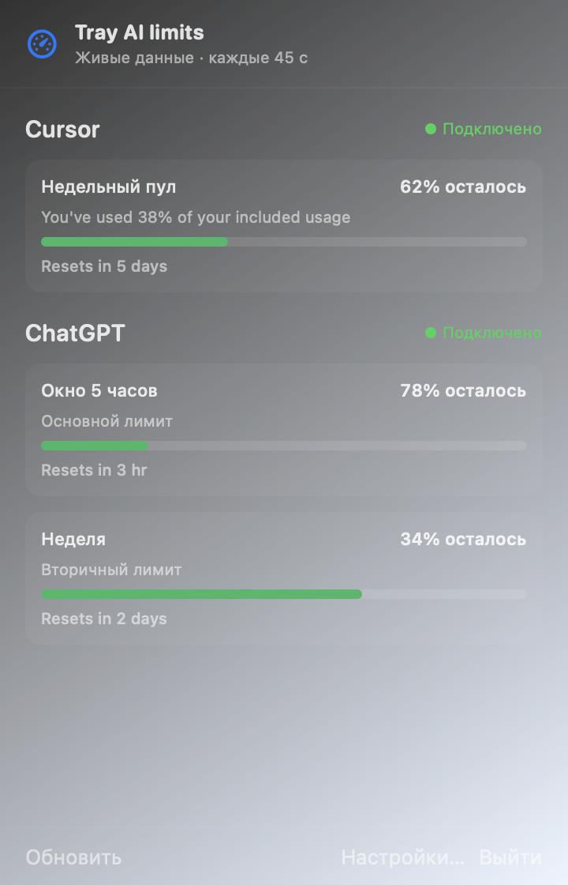
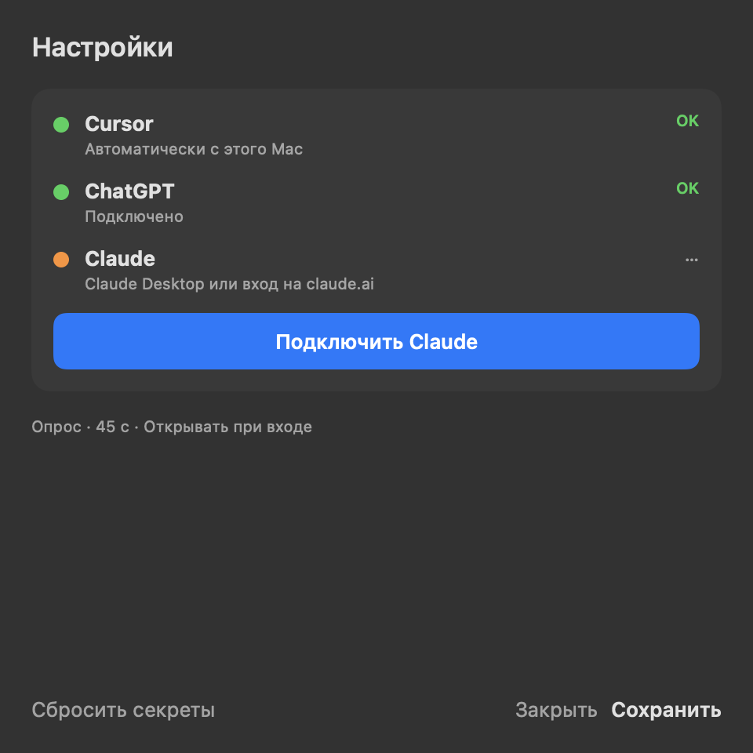

# Tray AI limits

Native macOS menu-bar app for live **Cursor** / **ChatGPT** / **Claude** usage limits.

Нативное приложение в строке меню macOS: живые лимиты Cursor, ChatGPT и Claude — без паролей Keychain в обычном сценарии.

Репозиторий: [`cursor-limits-tray`](https://github.com/alebastr12/cursor-limits-tray) (имя продукта — **Tray AI limits**).


## Что это

**Tray AI limits** показывает остаток лимитов прямо в menu bar (иконка + `%` для каждого подключённого сервиса) и в компактном popover. Опрос раз в ~45 с. В трее и popover видны только подключённые провайдеры — без букв `C`/`G`/`A` и без заглушек.

macOS 14+, не нотаризовано (ad-hoc подпись).

## Функции

- Живые проценты в строке меню и подробности в popover
- Cursor — токен с этого Mac / cookie (кэш в Keychain приложения)
- ChatGPT и Claude — вход в окне приложения (WKWebView), без чтения паролей браузера
- «Открывать при входе» включено по умолчанию
- Advanced — опциональный импорт из браузера / Safe Storage (может спросить пароль Keychain)

## Скриншоты

### Popover



### Настройки



### Строка меню


### Иконка приложения


## Установка

### DMG (рекомендуется) — v0.2.11

1. Скачайте [**TrayAILimits-0.2.11.dmg**](https://github.com/alebastr12/cursor-limits-tray/releases/download/v0.2.11/TrayAILimits-0.2.11.dmg) или откройте [последний релиз](https://github.com/alebastr12/cursor-limits-tray/releases/latest).
2. Перетащите `TrayAILimits.app` в **Программы** (в Finder отображается как **Tray AI limits**).
3. Первый запуск: правый клик → **Открыть** (приложение ad-hoc, Gatekeeper спросит подтверждение).
4. Старую `CursorLimitsTray.app` можно удалить из Программ.

### Из исходников

```bash
git clone https://github.com/alebastr12/cursor-limits-tray.git
cd cursor-limits-tray
./Scripts/build-app.sh
./Scripts/package-dmg.sh 0.2.11
open dist/TrayAILimits-0.2.11.dmg
```

Нужны Xcode Command Line Tools / Swift toolchain.

## Использование

1. Запустите приложение — иконка с полосками появится в строке меню.
2. Клик по иконке открывает popover с живыми данными.
3. **Настройки…** — подключение провайдеров.

### Cursor

Обычно подхватывается автоматически с этого Mac (токен кэшируется в Keychain приложения). Если нет — в **Advanced** вставьте session cookie или bearer (без разблокировки чужих Keychain).

### ChatGPT

В Настройках нажмите **Подключить ChatGPT** → войдите в окне приложения. Пароль Keychain / SecurityAgent не нужен.

### Claude

**Подключить Claude** → вход на claude.ai в окне приложения. После подключения Claude появится в трее и popover.

### Трей

Показываются только подключённые сервисы: узнаваемая иконка провайдера + `%`. Цвет — зелёный / оранжевый / красный по остатку. Закрытие окон (✕ / ⌘W) не завершает приложение — оно остаётся в меню.

### Настройки

- Интервал опроса (по умолчанию 45 с)
- Демо-данные
- Открывать при входе
- **Advanced** — ручные cookie и импорт из браузера (опционально)
- **Сбросить секреты** — очистить сохранённые токены

## Автозапуск

«Открывать при входе» **включено по умолчанию** (`SMAppService`). Отключить можно в Настройках.

Если запускаете с DMG, приложение предложит скопировать себя в **Программы** — так login item работает надёжнее, без цикла запросов пароля администратора.

## FAQ

### Будут ли пароли Keychain / SecurityAgent?

**Нет при обычном использовании.** Запуск, опрос и кнопки «Подключить ChatGPT / Claude» не трогают Keychain браузера и Cursor Safe Storage.

| Действие | Диалоги |
|----------|---------|
| Запуск / опрос | **Нет** (нет Safe Storage; Keychain только если уже сохраняли сессию) |
| Подключить ChatGPT / Claude | Нет (Keychain) |
| Открывать при входе / копия с DMG | Без admin-цикла |
| **Advanced** → браузер / Safe Storage | Может спросить пароль — опционально |

### Зачем Advanced?

Только если авто / окно входа не сработали: вставить cookie вручную или один раз импортировать из браузера. Для повседневной работы не нужно.

### Почему Claude нет в трее?

Не подключён. Подключите в Настройках — появится и процент `A…%`, и блок в popover.

### Gatekeeper / «не удаётся открыть»

Правый клик по приложению → **Открыть**. Ad-hoc подпись, без Apple notarization.

## Релизы

Все версии и DMG: **[Releases](https://github.com/alebastr12/cursor-limits-tray/releases)**  
Актуальный: [v0.2.11](https://github.com/alebastr12/cursor-limits-tray/releases/tag/v0.2.11)

## Лицензия

[MIT](LICENSE)
