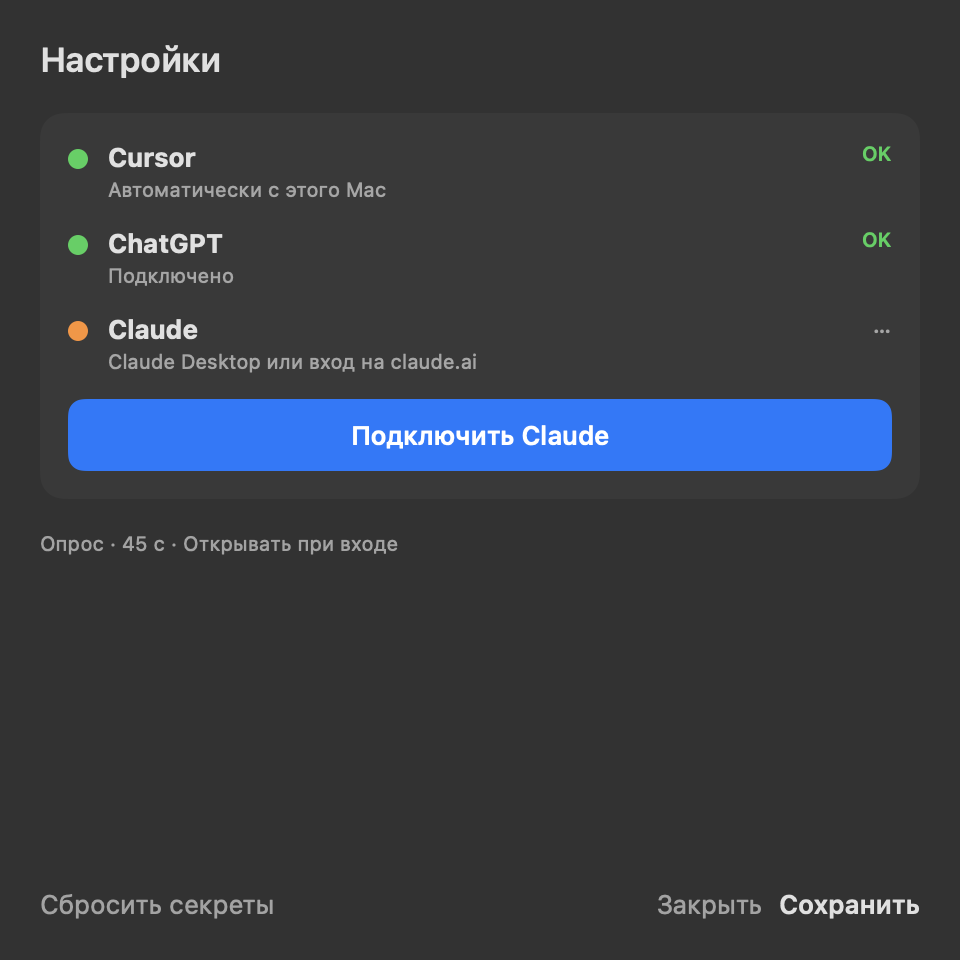

# Tray AI limits

Native macOS menu-bar app for live **Cursor** / **ChatGPT** / **Claude** / **OpenCode Go** usage limits.

Нативное приложение в строке меню macOS: живые лимиты OpenCode Go, Cursor, ChatGPT и Claude.

Репозиторий: [`cursor-limits-tray`](https://github.com/alebastr12/cursor-limits-tray) (имя продукта — **Tray AI limits**).


## Что это

**Tray AI limits** показывает остаток лимитов прямо в menu bar (иконка + все `%` каждого подключённого сервиса) и в компактном попапе. Опрос раз в ~45 с (настраивается). В трее и попапе видны только подключённые провайдеры с оставшимися лимитами. Если у провайдера несколько лимитов, в строке меню показываются все. При наведении на трей — подсказка с типами лимитов (5ч / неделя / месяц) и остатком `%`.

## Функции

- Живые проценты в строке меню и подробности в попапе
- Cursor — токен с этого Mac / cookie (хранится в файле приложения `0600`, без запросов Keychain)
- ChatGPT и Claude — вход в окне приложения (WKWebView), без чтения паролей браузера
- ChatGPT: если web-сессия истекла — локальный fallback на вход Codex CLI (источник виден в попапе)
- OpenCode Go — лимиты 5ч / неделя / месяц из локального входа OpenCode или Go API key
- Опциональные уведомления о низком остатке (≤15%, не чаще раза в 12 часов)
- Автообновление из GitHub Releases (можно отключить в Настройках)

## Что нового в 0.2.32

- **Автообновление**: чекбокс в Настройках, проверка GitHub Releases раз в сутки и при запуске, скачивание ZIP, проверка SHA-256, замена приложения и перезапуск.
- Кнопка **«Проверить обновления»** и статус проверки.
- Developer ID не требуется; при отсутствии прав предлагается установить DMG вручную.
- README: убрана фраза про «без паролей Keychain», «popover» в русском тексте заменён на «попап».
- Тесты: **51**.

## Что нового в 0.2.31

- Опциональные **уведомления о низком остатке**: порог ≤15%, не чаще одного раза на провайдера/лимит в 12 часов. Включаются в Настройках, macOS один раз спросит разрешение.
- Обновлён скриншот попапа: логотипы провайдеров и OpenCode Go.
- Настройки OpenCode Go показывают источник: OpenCode CLI или Go API key.
- Тесты: **45**.

## Что нового в 0.2.30

- В попапе слева от названий провайдеров — логотипы Cursor / ChatGPT / Claude / OpenCode Go.
- Своя template-иконка OpenCode в строке меню (вместо SF Symbol).
- Hover-подсказка: заголовки провайдеров выделены полужирным, между провайдерами пустая строка, предупреждение — оранжевым.
- Настройки OpenCode Go показывают источник: OpenCode CLI или Go API key.
- Интеграционные тесты OpenCode/Claude/Cursor и чтения локального OpenCode credential — **43 теста**.

## Что нового в 0.2.27

- Добавлен провайдер **OpenCode Go**: 5-часовое, недельное и месячное окна.
- Ключ берётся автоматически из локального входа OpenCode (`~/.local/share/opencode/opencode.db`); если его нет — в **Advanced** можно вставить Go API key.
- OpenCode Go отключается/подключается через Настройки, как остальные провайдеры.
- Обновлены иконка в трее, высота попапа (4 провайдера) и тесты (36).

## Что нового в 0.2.26

- Удаление провайдеров перенесено в **Настройки**: красный `✕` в правой части строки Cursor / ChatGPT / Claude, с подтверждением.
- Настройки теперь открываются **отдельным окном**, попап закрывается. Диалог подтверждения больше не перекрывается панелью.
- В попапе удаления нет — только проценты и статус.
- Убран случайно появлявшийся отладочный экран при обычном запуске.

## Что нового в 0.2.23

- **Свои сессии больше не используют Keychain вообще.** Они хранятся в `~/Library/Application Support/TrayAILimits/secrets.json` с правами `0600`; при запуске и подключении нет запросов пароля login Keychain (включая запуск как login item при заблокированной связке).
- ChatGPT переносится из старого Keychain автоматически, когда Keychain разблокирован. Для токена Cursor со старым ACL в Настройках есть кнопка **«Перенести сохранённый токен Cursor»** — она один раз спросит пароль Keychain, после чего токен живёт в файле.
- Старые Keychain-элементы (v1/v2) игнорируются и больше не читаются на обычном пути.
- Чужие Keychain (Cursor Safe Storage, браузеры) по-прежнему доступны только через Advanced и могут запросить пароль.

**Безопасность:** файл `secrets.json` имеет права `0600` (доступен приложениям этого пользователя), каталог `0700`; диск защищён FileVault. Это практический уровень доступа как у прежнего ACL «any app», но без Keychain-диалогов.

## Что нового в 0.2.22

- В правой части строки каждого провайдера — красный крестик. Он отключает провайдера после подтверждения в диалоге: удаляет сохранённую сессию и убирает строку из попапа.
- Для Claude отключение теперь очищает и cookie окна входа; ChatGPT — тоже. Cursor удаляет сохранённый токен.
- Высота попапа/панели теперь следует за числом видимых провайдеров и не обрезается после удаления.

## Что нового в 0.2.21

- **Больше нет запросов пароля Keychain при запуске и подключении провайдеров.** Свои сессии переехали в отдельную service `local.cursor-limits-tray.v2` с ACL, не привязанным к подписи приложения: macOS не показывает SecurityAgent, а элементы остаются зашифрованными login Keychain.
- Старые элементы (v1) больше не читаются — они не могут вызвать запрос. После обновления ChatGPT восстанавливается из окна входа автоматически; Cursor/Claude нужно один раз подключить заново.
- Убраны кнопки «Восстановить сохранённые сессии»: они больше не нужны.

## Что нового в 0.2.20

- Установка из DMG больше не требует пароля администратора: если `/Applications` недоступна для записи (или там чужая копия), приложение ставится в `~/Applications`.
- Перед установкой приложение закрывает старые запущенные копии, чтобы замена проходила без «файл используется».
- Новый `./Scripts/trust-signing.sh` — доверие сертификату `TrayAILimits Dev` только для текущего пользователя, без admin (системный trust store не трогается).
- Обновлены тексты установки и README.

## Что нового в 0.2.19

- Claude с устаревшим cookie больше не показывается в попапе, если он ни разу не дал данных; тревожный треугольник для него тоже не появляется.
- В Настройках появились кнопки **«Отключить ChatGPT / Claude»** — можно убрать ненужный провайдер вместе с сохранённым секретом.
- После смены подписи приложения сохранённые сессии можно восстановить одной кнопкой **«Восстановить сохранённые сессии»** (macOS один раз спросит разрешение Keychain).
- Провайдер считается видимым только при наличии реальных данных или прошлой успешной загрузки.

## Что нового в 0.2.18

- Индикатор `⚠` в трее, если настроенный провайдер не смог обновиться; причина — в подсказке при наведении.
- «Обновлено X назад» в каждой секции попапа.
- Общее окно входа для ChatGPT и Claude (меньше дублирования, поведение прежнее).
- Интеграционные тесты HTTP: успешный refresh, `RefreshAccessTokenError`, `401 token_expired`, Codex-fallback — всего 27 тестов.

## Что нового в 0.2.17

- Исправлено «замерзание» лимитов ChatGPT: истёкшая сессия (`RefreshAccessTokenError`) теперь видна в попапе, а не молча оставляет старые проценты.
- Fallback на локальный вход **Codex CLI** (`~/.codex/auth.json`), если web-сессия ChatGPT мертва; источник показан в попапе.
- Сессия ChatGPT восстанавливается из окна входа без пароля Keychain; «Сбросить секреты» очищает и её.
- Провайдеры опрашиваются параллельно, HTTP-клиент общий и без кэша — «Обновить» всегда идёт в сеть.
- Полная локализация деталей Cursor/Claude/ChatGPT, скрытые поля cookie в Настройках.
- Стабильная подпись сборки, тесты парсеров, диагностика `--probe-chatgpt`.

## Скриншоты

### Попап


### Настройки



### Строка меню


### Иконка приложения


## Установка

### DMG (рекомендуется) — v0.2.32

1. Скачайте [**TrayAILimits-0.2.32.dmg**](https://github.com/alebastr12/cursor-limits-tray/releases/download/v0.2.32/TrayAILimits-0.2.32.dmg) или откройте [последний релиз](https://github.com/alebastr12/cursor-limits-tray/releases/latest).
2. Перетащите `TrayAILimits.app` в **Программы** (в Finder отображается как **Tray AI limits**).
3. Первый запуск: правый клик → **Открыть** (приложение не нотаризовано, Gatekeeper спросит подтверждение).
4. Старую `CursorLimitsTray.app` можно удалить из Программ.

Интерфейс следует языку macOS (`preferredLanguages`): English + Русский через `Localizable.strings`.

### Из исходников

```bash
git clone https://github.com/alebastr12/cursor-limits-tray.git
cd cursor-limits-tray
./Scripts/setup-signing.sh                  # один раз: identity TrayAILimits Dev
export CODESIGN_IDENTITY="TrayAILimits Dev"
./Scripts/package-dmg.sh 0.2.32
./Scripts/package-release.sh 0.2.32
open dist/TrayAILimits-0.2.32.dmg
```

Артефакты релиза: `dist/TrayAILimits-0.2.32.dmg`, `dist/TrayAILimits-0.2.32.zip` и стабильные копии `TrayAILimits-macOS.zip`.

Нужны Xcode Command Line Tools / Swift toolchain.

Стабильная подпись (важно для Keychain): один раз создайте локальный сертификат:

```bash
./Scripts/setup-signing.sh
./Scripts/build-app.sh
```

`build-app.sh` сам выбирает `CODESIGN_IDENTITY` → «TrayAILimits Dev» → «Apple Development» → ad-hoc. Ad-hoc подпись меняется при каждой пересборке, из-за чего macOS может «забыть» сохранённые сессии и попросить подключить провайдеров заново. Если создан `TrayAILimits Dev`, он имеет приоритет, чтобы обычная пересборка не меняла Keychain ACL.

Доверие сертификату только для текущего пользователя (без пароля администратора):

```bash
./Scripts/trust-signing.sh
```

Системный trust store (`-d`) требует admin и для локальной сборки не нужен; notarization это не заменяет.

Тесты:

```bash
swift test
```

## Использование

1. Запустите приложение — иконка с полосками появится в строке меню.
2. Клик по иконке открывает попап с живыми данными.
3. **Настройки…** — подключение провайдеров.

### Cursor

Обычно подхватывается автоматически с этого Mac (токен хранится в файле приложения с правами `0600`). Если нет — в **Advanced** вставьте session cookie или bearer (без разблокировки чужих Keychain).

### ChatGPT

В Настройках нажмите **Подключить ChatGPT** → войдите в окне приложения. Пароль Keychain / SecurityAgent не нужен.

Сессия chatgpt.com периодически истекает на стороне OpenAI (`RefreshAccessTokenError`). В этом случае приложение показывает ошибку в попапе и предлагает войти заново. Пока сессия не восстановлена, лимиты читаются из локального входа **Codex CLI** (`~/.codex/auth.json`), если он есть на этом Mac — источник виден в попапе как «через Codex CLI». Токен Codex не копируется в Keychain приложения и перечитывается при каждом опросе.

### Claude

**Подключить Claude** → вход на claude.ai в окне приложения. После подключения Claude появится в трее и попап.

### OpenCode Go

Обычно подхватывается автоматически из локального входа OpenCode (`~/.local/share/opencode/opencode.db`). Показывает окна 5 часов / неделя / месяц. Если локального входа нет — Настройки → **Advanced** → **OpenCode Go API key** (ключ из [Console](https://opencode.ai/console)). Отключение — красный `✕` в Настройках.

### Трей

Показываются только подключённые сервисы: узнаваемая иконка провайдера + `%`. Цвет — зелёный / оранжевый / красный по остатку. Закрытие окон (✕ / ⌘W) не завершает приложение — оно остаётся в меню.

### Настройки

- Интервал опроса (по умолчанию 45 с)
- Демо-данные
- Открывать при входе
- Уведомления о низком остатке (опционально)
- Автообновление (включено по умолчанию, можно отключить)
- **Advanced** — ручные cookie, OpenCode Go API key и импорт из браузера (опционально)
- **Сбросить секреты** — очистить сохранённые токены

## Автозапуск

«Открывать при входе» **включено по умолчанию** (`SMAppService`). Отключить можно в Настройках.

Если запускаете с DMG, приложение предложит установить себя в **Программы** (а если системная папка недоступна для записи — в `~/Applications`) и закроет старые запущенные копии. Пароль администратора не нужен; так login item работает надёжнее.

## Диагностика

Проверить источники ChatGPT без вывода токенов:

```bash
./dist/TrayAILimits.app/Contents/MacOS/CursorLimitsTray --probe-chatgpt
```

Печатает строки `app-session:` (cookie из файла / окна входа) и `codex-cli:` (локальный вход Codex) — только статус, названия лимитов и проценты. `--probe-keychain` показывает файловое хранилище, состояние Keychain и флаги наличия секретов (без значений).

## FAQ

### Будут ли пароли Keychain / SecurityAgent?

**Нет при обычном использовании.** Запуск, опрос и кнопки «Подключить ChatGPT / Claude» не трогают Keychain браузера и Cursor Safe Storage.

| Действие | Диалоги |
|----------|---------|
| Запуск / опрос | **Нет** (свои сессии — в файле `0600`, Keychain не используется) |
| Подключить ChatGPT / Claude | Нет (Keychain) |
| Открывать при входе / копия с DMG | Без admin-цикла |
| **Advanced** → браузер / Safe Storage | Может спросить пароль — опционально |

### Почему Keychain больше не спрашивает пароль?

Свои сессии хранятся в `~/Library/Application Support/TrayAILimits/secrets.json` с правами `0600` (каталог `0700`); Keychain на обычном пути не используется. Поэтому нет запросов пароля ни при запуске, ни при подключении, ни после переподписи приложения. Практический уровень доступа — как у файла `0600`: приложения этого пользователя могут его прочитать; диск защищает FileVault. Чужие Keychain (Cursor Safe Storage, браузеры) по-прежнему читаются только в **Advanced** и могут запросить пароль.

### Зачем Advanced?

Только если авто / окно входа не сработали: вставить cookie вручную или один раз импортировать из браузера. Для повседневной работы не нужно.

### Почему Claude нет в трее?

Не подключён. Подключите в Настройках — появится и процент `A…%`, и блок в попапе.

### После пересборки просят подключить провайдеров заново

Так работает ad-hoc подпись: каждый билд получает новую code identity, а Keychain ACL привязан именно к ней. Один раз выполните `./Scripts/setup-signing.sh` (или соберите с `CODESIGN_IDENTITY="Apple Development: …"`) — и сохранённые сессии переживут пересборки. ChatGPT дополнительно восстанавливается из persistent-хранилища окна входа без пароля.

### Gatekeeper / «не удаётся открыть»

Правый клик по приложению → **Открыть**. Локальная подпись (`TrayAILimits Dev` / Apple Development или ad-hoc), без Apple notarization. Apple Developer ID не требуется. Проверить: `codesign -dvv dist/TrayAILimits.app`.

## Релизы

Все версии и DMG: **[Releases](https://github.com/alebastr12/cursor-limits-tray/releases)**  
Актуальный: [v0.2.32](https://github.com/alebastr12/cursor-limits-tray/releases/tag/v0.2.32)

## Лицензия

[MIT](LICENSE)
