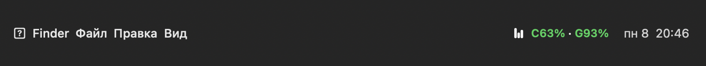
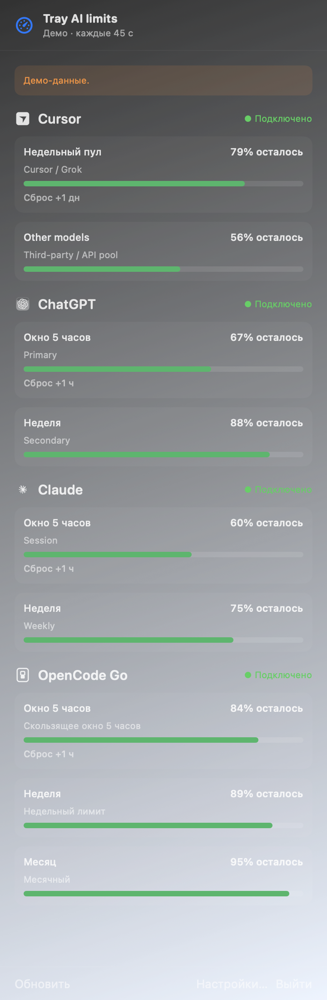

# Tray AI limits

Native macOS menu-bar app for live **Cursor** / **ChatGPT** / **Claude** usage limits.

Нативное приложение в строке меню macOS: живые лимиты Cursor, ChatGPT и Claude — без паролей Keychain в обычном сценарии.

Репозиторий: [`cursor-limits-tray`](https://github.com/alebastr12/cursor-limits-tray) (имя продукта — **Tray AI limits**).



## Что это

**Tray AI limits** показывает остаток лимитов прямо в menu bar (иконка + все `%` каждого подключённого сервиса) и в компактном popover. Опрос раз в ~45 с. В трее и popover видны только подключённые провайдеры — без букв `C`/`G`/`A` и без заглушек. Если у провайдера несколько лимитов, в строке меню показываются все. Popover открывается поверх fullscreen Space; при наведении на трей — подсказка с типами лимитов (5ч / неделя / месяц) и остатком `%`.

macOS 14+, не нотаризовано (локальная подпись TrayAILimits Dev / Apple Development либо ad-hoc).

## Функции

- Живые проценты в строке меню и подробности в popover
- Cursor — токен с этого Mac / cookie (хранится в защищённом хранилище приложения, без запросов пароля)
- ChatGPT и Claude — вход в окне приложения (WKWebView), без чтения паролей браузера
- ChatGPT: если web-сессия истекла — локальный fallback на вход Codex CLI (источник виден в popover)
- «Открывать при входе» включено по умолчанию
- Advanced — опциональный импорт из браузера / Safe Storage (может спросить пароль Keychain)

## Что нового в 0.2.21

- **Больше нет запросов пароля Keychain при запуске и подключении провайдеров.** Свои сессии переехали в отдельную service `local.cursor-limits-tray.v2` с ACL, не привязанным к подписи приложения: macOS не показывает SecurityAgent, а элементы остаются зашифрованными login Keychain.
- Старые элементы (v1) больше не читаются — они не могут вызвать запрос. После обновления ChatGPT восстанавливается из окна входа автоматически; Cursor/Claude нужно один раз подключить заново.
- Убраны кнопки «Восстановить сохранённые сессии»: они больше не нужны.

## Что нового в 0.2.20

- Установка из DMG больше не требует пароля администратора: если `/Applications` недоступна для записи (или там чужая копия), приложение ставится в `~/Applications`.
- Перед установкой приложение закрывает старые запущенные копии, чтобы замена проходила без «файл используется».
- Новый `./Scripts/trust-signing.sh` — доверие сертификату `TrayAILimits Dev` только для текущего пользователя, без admin (системный trust store не трогается).
- Обновлены тексты установки и README.

## Что нового в 0.2.19

- Claude с устаревшим cookie больше не показывается в popover, если он ни разу не дал данных; тревожный треугольник для него тоже не появляется.
- В Настройках появились кнопки **«Отключить ChatGPT / Claude»** — можно убрать ненужный провайдер вместе с сохранённым секретом.
- После смены подписи приложения сохранённые сессии можно восстановить одной кнопкой **«Восстановить сохранённые сессии»** (macOS один раз спросит разрешение Keychain).
- Провайдер считается видимым только при наличии реальных данных или прошлой успешной загрузки.

## Что нового в 0.2.18

- Индикатор `⚠` в трее, если настроенный провайдер не смог обновиться; причина — в подсказке при наведении.
- «Обновлено X назад» в каждой секции popover.
- Общее окно входа для ChatGPT и Claude (меньше дублирования, поведение прежнее).
- Интеграционные тесты HTTP: успешный refresh, `RefreshAccessTokenError`, `401 token_expired`, Codex-fallback — всего 27 тестов.

## Что нового в 0.2.17

- Исправлено «замерзание» лимитов ChatGPT: истёкшая сессия (`RefreshAccessTokenError`) теперь видна в popover, а не молча оставляет старые проценты.
- Fallback на локальный вход **Codex CLI** (`~/.codex/auth.json`), если web-сессия ChatGPT мертва; источник показан в popover.
- Сессия ChatGPT восстанавливается из окна входа без пароля Keychain; «Сбросить секреты» очищает и её.
- Провайдеры опрашиваются параллельно, HTTP-клиент общий и без кэша — «Обновить» всегда идёт в сеть.
- Полная локализация деталей Cursor/Claude/ChatGPT, скрытые поля cookie в Настройках.
- Стабильная подпись сборки, тесты парсеров, диагностика `--probe-chatgpt`.

## Скриншоты

### Popover



### Настройки


### Строка меню


### Иконка приложения


## Установка

### DMG (рекомендуется) — v0.2.21

1. Скачайте [**TrayAILimits-0.2.21.dmg**](https://github.com/alebastr12/cursor-limits-tray/releases/download/v0.2.21/TrayAILimits-0.2.21.dmg) или откройте [последний релиз](https://github.com/alebastr12/cursor-limits-tray/releases/latest).
2. Перетащите `TrayAILimits.app` в **Программы** (в Finder отображается как **Tray AI limits**).
3. Первый запуск: правый клик → **Открыть** (приложение не нотаризовано, Gatekeeper спросит подтверждение).
4. Старую `CursorLimitsTray.app` можно удалить из Программ.

Интерфейс следует языку macOS (`preferredLanguages`): English + Русский через `Localizable.strings`.

### Из исходников

```bash
git clone https://github.com/alebastr12/cursor-limits-tray.git
cd cursor-limits-tray
./Scripts/setup-signing.sh                  # один раз: identity TrayAILimits Dev
export CODESIGN_IDENTITY="TrayAILimits Dev"
./Scripts/package-dmg.sh 0.2.21
./Scripts/package-release.sh 0.2.21
open dist/TrayAILimits-0.2.21.dmg
```

Артефакты релиза: `dist/TrayAILimits-0.2.21.dmg`, `dist/TrayAILimits-0.2.21.zip` и стабильные копии `TrayAILimits-macOS.*`.

Нужны Xcode Command Line Tools / Swift toolchain.

Стабильная подпись (важно для Keychain): один раз создайте локальный сертификат:

```bash
./Scripts/setup-signing.sh
./Scripts/build-app.sh
```

`build-app.sh` сам выбирает `CODESIGN_IDENTITY` → «TrayAILimits Dev» → «Apple Development» → ad-hoc. Ad-hoc подпись меняется при каждой пересборке, из-за чего macOS может «забыть» сохранённые сессии и попросить подключить провайдеров заново. Если создан `TrayAILimits Dev`, он имеет приоритет, чтобы обычная пересборка не меняла Keychain ACL.

Доверие сертификату только для текущего пользователя (без пароля администратора):

```bash
./Scripts/trust-signing.sh
```

Системный trust store (`-d`) требует admin и для локальной сборки не нужен; notarization это не заменяет.

Тесты:

```bash
swift test
```

## Использование

1. Запустите приложение — иконка с полосками появится в строке меню.
2. Клик по иконке открывает popover с живыми данными.
3. **Настройки…** — подключение провайдеров.

### Cursor

Обычно подхватывается автоматически с этого Mac (токен кэшируется в Keychain приложения). Если нет — в **Advanced** вставьте session cookie или bearer (без разблокировки чужих Keychain).

### ChatGPT

В Настройках нажмите **Подключить ChatGPT** → войдите в окне приложения. Пароль Keychain / SecurityAgent не нужен.

Сессия chatgpt.com периодически истекает на стороне OpenAI (`RefreshAccessTokenError`). В этом случае приложение показывает ошибку в popover и предлагает войти заново. Пока сессия не восстановлена, лимиты читаются из локального входа **Codex CLI** (`~/.codex/auth.json`), если он есть на этом Mac — источник виден в popover как «через Codex CLI». Токен Codex не копируется в Keychain приложения и перечитывается при каждом опросе.

### Claude

**Подключить Claude** → вход на claude.ai в окне приложения. После подключения Claude появится в трее и popover.

### Трей

Показываются только подключённые сервисы: узнаваемая иконка провайдера + `%`. Цвет — зелёный / оранжевый / красный по остатку. Закрытие окон (✕ / ⌘W) не завершает приложение — оно остаётся в меню.

### Настройки

- Интервал опроса (по умолчанию 45 с)
- Демо-данные
- Открывать при входе
- **Advanced** — ручные cookie и импорт из браузера (опционально)
- **Сбросить секреты** — очистить сохранённые токены

## Автозапуск

«Открывать при входе» **включено по умолчанию** (`SMAppService`). Отключить можно в Настройках.

Если запускаете с DMG, приложение предложит установить себя в **Программы** (а если системная папка недоступна для записи — в `~/Applications`) и закроет старые запущенные копии. Пароль администратора не нужен; так login item работает надёжнее.

## Диагностика

Проверить источники ChatGPT без вывода токенов:

```bash
./dist/TrayAILimits.app/Contents/MacOS/CursorLimitsTray --probe-chatgpt
```

Печатает строки `app-session:` (cookie из Keychain / окна входа) и `codex-cli:` (локальный вход Codex) — только статус, названия лимитов и проценты.

## FAQ

### Будут ли пароли Keychain / SecurityAgent?

**Нет при обычном использовании.** Запуск, опрос и кнопки «Подключить ChatGPT / Claude» не трогают Keychain браузера и Cursor Safe Storage.

| Действие | Диалоги |
|----------|---------|
| Запуск / опрос | **Нет** (свои сессии — в Keychain с ACL без запроса пароля) |
| Подключить ChatGPT / Claude | Нет (Keychain) |
| Открывать при входе / копия с DMG | Без admin-цикла |
| **Advanced** → браузер / Safe Storage | Может спросить пароль — опционально |

### Почему Keychain больше не спрашивает пароль?

Свои сессии хранятся в login Keychain в отдельной service `local.cursor-limits-tray.v2` с ACL, не привязанным к подписи приложения. macOS не показывает SecurityAgent, а данные остаются зашифрованными Keychain. Практический уровень доступа — как у файла `0600`: приложения этого пользователя могут их прочитать. Чужие Keychain (Cursor Safe Storage, браузеры) по-прежнему читаются только в **Advanced** и могут запросить пароль.

### Зачем Advanced?

Только если авто / окно входа не сработали: вставить cookie вручную или один раз импортировать из браузера. Для повседневной работы не нужно.

### Почему Claude нет в трее?

Не подключён. Подключите в Настройках — появится и процент `A…%`, и блок в popover.

### После пересборки просят подключить провайдеров заново

Так работает ad-hoc подпись: каждый билд получает новую code identity, а Keychain ACL привязан именно к ней. Один раз выполните `./Scripts/setup-signing.sh` (или соберите с `CODESIGN_IDENTITY="Apple Development: …"`) — и сохранённые сессии переживут пересборки. ChatGPT дополнительно восстанавливается из persistent-хранилища окна входа без пароля.

### Gatekeeper / «не удаётся открыть»

Правый клик по приложению → **Открыть**. Локальная подпись (`TrayAILimits Dev` / Apple Development или ad-hoc), без Apple notarization. Проверить: `codesign -dvv dist/TrayAILimits.app`.

## Релизы

Все версии и DMG: **[Releases](https://github.com/alebastr12/cursor-limits-tray/releases)**  
Актуальный: [v0.2.21](https://github.com/alebastr12/cursor-limits-tray/releases/tag/v0.2.21)

## Лицензия

[MIT](LICENSE)
